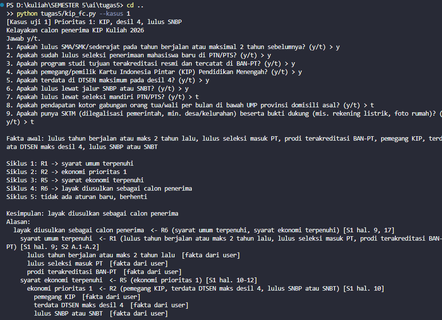
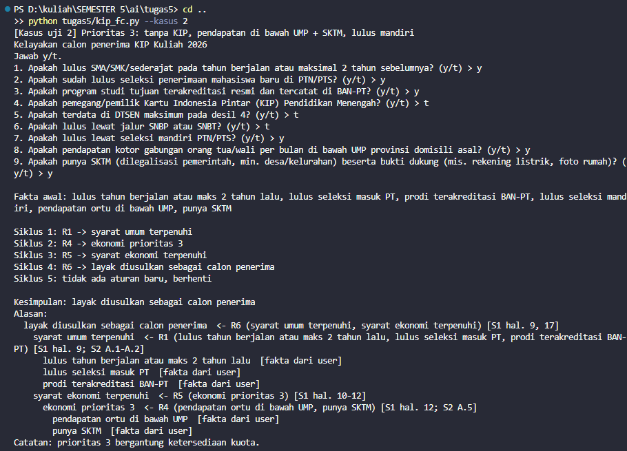
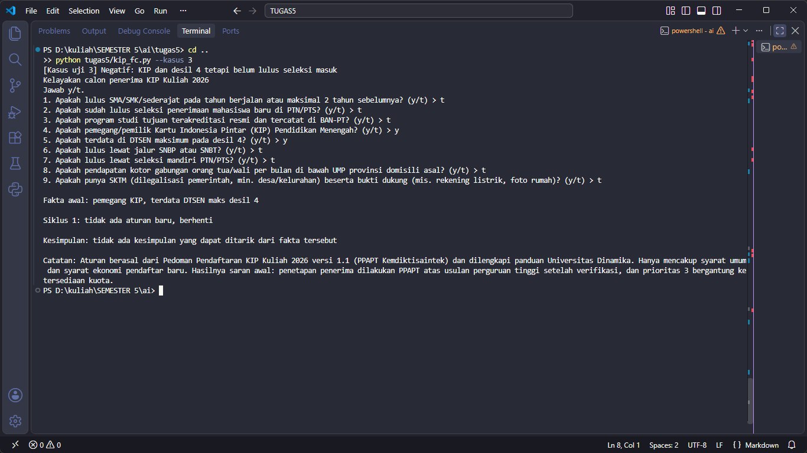
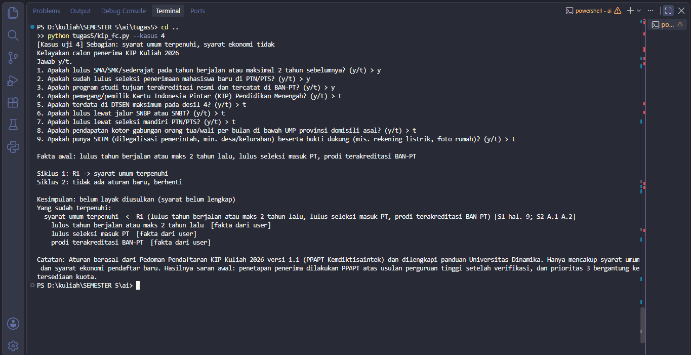

# Tugas 5: Sistem Pakar Kelayakan Calon Penerima KIP Kuliah 2026

## 1. Identitas

- Nama: **AHMAD DANI**
- NIM: **F1D02410140**
- Mata kuliah: Kecerdasan Buatan, Teknik Informatika UNRAM

## 2. Topik dan cara menjalankan

**Topik:** menentukan apakah seorang calon mahasiswa **layak diusulkan sebagai calon penerima KIP Kuliah 2026**, berdasarkan syarat umum dan syarat ekonomi dalam pedoman resmi.

**Bahasa:** Python 3.8.

**Struktur repository:**

```
ai-tugas5/
├── README.md
├── kip_fc.py
├── kb_kip.json
├── sumber/
│   ├── S1-pedoman-kip-kuliah-2026.pdf
│   └── S2-panduan-dinamika-2026.pdf
└── screenshot/
    ├── kasus1.png
    ├── kasus2.png
    └── kasus3.png
```

| File | Isi |
|---|---|
| `kb_kip.json` | basis pengetahuan: sumber, pertanyaan, aturan IF-THEN, kasus uji |
| `kip_fc.py` | mesin forward chaining (ditulis sendiri) dan antarmuka tanya-jawab |
| `sumber/` | salinan dokumen sumber yang dipakai |
| `screenshot/` | tangkapan layar tiga kasus uji |

**Cara running program**:

```
python kip_fc.py              # interaktif, jawab y/t
python kip_fc.py --kasus 1    # jalankan kasus uji nomor 1 sampai 4
```

## 3. Sumber dan aturan

### Sumber

| Kode | Sumber |
|---|---|
| S1 | *Pedoman Pendaftaran Program KIP Kuliah 2026* (versi 1.1), Pusat Pembiayaan dan Asesmen Pendidikan Tinggi (PPAPT), Kemdiktisaintek. Dipublikasikan melalui portal https://kip-kuliah.kemdiktisaintek.go.id/ (tidak ada tautan unduh langsung). Salinan: [sumber/S1-pedoman-kip-kuliah-2026.pdf](sumber/S1-pedoman-kip-kuliah-2026.pdf). Diakses **[ISI TANGGAL]**. |
| S2 | *Panduan Pendaftaran KIP Kuliah 2026*, Universitas Dinamika. https://www.dinamika.ac.id/wp-content/uploads/2026/06/PANDUAN-PENDAFTARAN-KIP-KULIAH-2026.pdf . Salinan: [sumber/S2-panduan-dinamika-2026.pdf](sumber/S2-panduan-dinamika-2026.pdf). Diakses **[ISI TANGGAL]**. |

S1 adalah sumber utama (dokumen resmi kementerian). S2 adalah dokumen perguruan tinggi yang memuat syarat umum yang sama.

**Perbedaan antar sumber.** Batas penghasilan keluarga berbeda: S1 (hal. 12) menyebut pendapatan kotor gabungan orang tua/wali per bulan **di bawah UMP provinsi domisili asal**, sedangkan S2 (A.5a) menyebut **maksimal Rp4.000.000 per bulan atau Rp750.000 per anggota keluarga**. Program ini mengikuti **S1** karena itu dokumen resmi kementerian. S2 juga memuat jalur lain (DTKS, PKH, KKS, P3KE, panti sosial) yang tidak ada di S1, sehingga tidak dimasukkan.

### Tabel aturan

| Aturan | IF | THEN | Sumber |
|---|---|---|---|
| R1 | lulus SMA/SMK tahun berjalan atau maks 2 tahun lalu **AND** lulus seleksi masuk PT **AND** prodi terakreditasi BAN-PT | syarat umum terpenuhi | S1 hal. 9; S2 A.1-A.2 |
| R2 | pemegang KIP **AND** terdata DTSEN maks desil 4 **AND** lulus SNBP/SNBT | ekonomi prioritas 1 | S1 hal. 10 |
| R3 | pemegang KIP **AND** terdata DTSEN maks desil 4 **AND** lulus seleksi mandiri | ekonomi prioritas 2 | S1 hal. 10 |
| R4 | pendapatan ortu di bawah UMP **AND** punya SKTM | ekonomi prioritas 3 | S1 hal. 12; S2 A.5 |
| R5 | ekonomi prioritas 1 **OR** 2 **OR** 3 | syarat ekonomi terpenuhi | S1 hal. 10-12 |
| R6 | syarat umum terpenuhi **AND** syarat ekonomi terpenuhi | layak diusulkan sebagai calon penerima | S1 hal. 9, 17 |

Ada 6 aturan dan 6 kesimpulan. Rantainya: R2/R3/R4 menghasilkan prioritas ekonomi, dipakai R5, hasil R5 dipakai R6.

Catatan penafsiran: pada S1 hal. 12, bukti pendapatan di bawah UMP (poin a) dan SKTM (poin b) ditulis berurutan. Aturan R4 menafsirkannya sebagai **keduanya harus ada**. Prioritas 3 juga bergantung ketersediaan kuota (S1 hal. 12), dan program menampilkan catatan itu.

## 4. Metode: forward chaining

**Alasan memilih FC:** fakta calon (KIP, desil, hasil seleksi, dan seterusnya) sudah diketahui user, dan yang dicari adalah kesimpulan kelayakan. Arah penalarannya dari fakta ke kesimpulan, sesuai FC. FC juga paling mudah menampilkan alasan karena tinggal mencatat aturan yang menghasilkan tiap fakta.

**Cara kerja:**

```
memori <- fakta yang dijawab "ya" oleh user
ULANGI:
    cocok <- aturan yang syaratnya terpenuhi DAN hasilnya belum ada di memori
    JIKA cocok kosong: BERHENTI
    r <- cocok[0]
    tambahkan r.maka ke memori
    catat bahwa r.maka berasal dari r
```

Syarat terpenuhi: mode `dan` berarti semua syarat ada di memori, mode `atau` berarti salah satu cukup. Aturan yang hasilnya sudah ada di memori tidak dijalankan lagi, sehingga program pasti berhenti. Fakta yang tidak pernah menjadi hasil aturan (sembilan fakta dasar) ditanyakan ke user.

## 5. Kasus uji

Tiga kasus pertama wajib; kasus 4 tambahan. Jalankan dengan `python kip_fc.py --kasus N`, atau jawab sendiri secara interaktif.

| # | Fakta "ya" | Hasil |
|---|---|---|
| 1 | lulus tahun berjalan, lulus seleksi masuk PT, prodi terakreditasi, pemegang KIP, desil maks 4, lulus SNBP/SNBT | **layak diusulkan** (prioritas 1) |
| 2 | lulus tahun berjalan, lulus seleksi masuk PT, prodi terakreditasi, lulus mandiri, pendapatan di bawah UMP, punya SKTM | **layak diusulkan** (prioritas 3, bergantung kuota) |
| 3 | pemegang KIP, desil maks 4 (belum lulus seleksi masuk) | **tidak ada kesimpulan** (kasus negatif) |
| 4 | lulus tahun berjalan, lulus seleksi masuk PT, prodi terakreditasi | **belum layak**, hanya syarat umum terpenuhi |

### Screenshot

**Kasus 1: prioritas 1 (layak)**



**Kasus 2: prioritas 3 (layak, bergantung kuota)**



**Kasus 3: negatif (tidak ada kesimpulan)**



**Kasus 4: sebagian (syarat umum terpenuhi, syarat ekonomi tidak)**



### Contoh keluaran (kasus 1)

```
Siklus 1: R1 -> syarat umum terpenuhi
Siklus 2: R2 -> ekonomi prioritas 1
Siklus 3: R5 -> syarat ekonomi terpenuhi
Siklus 4: R6 -> layak diusulkan sebagai calon penerima
Siklus 5: tidak ada aturan baru, berhenti

Kesimpulan: layak diusulkan sebagai calon penerima
Alasan:
  layak diusulkan sebagai calon penerima  <- R6 (syarat umum terpenuhi, syarat ekonomi terpenuhi) [S1 hal. 9, 17]
    syarat umum terpenuhi  <- R1 (...) [S1 hal. 9; S2 A.1-A.2]
    syarat ekonomi terpenuhi  <- R5 (ekonomi prioritas 1) [S1 hal. 10-12]
      ekonomi prioritas 1  <- R2 (pemegang KIP, terdata DTSEN maks desil 4, lulus SNBP atau SNBT) [S1 hal. 10]
```

## 6. Batas keberlakuan

Pengetahuan dalam program ini berasal dari Pedoman Pendaftaran KIP Kuliah 2026 versi 1.1 (PPAPT Kemdiktisaintek) dan panduan Universitas Dinamika, dan hanya berlaku untuk **pendaftar baru KIP Kuliah tahun 2026** pada aspek syarat umum dan syarat ekonomi. Program tidak memeriksa dokumen, tidak mengecek data DTSEN, dan tidak menghitung kuota. Penetapan penerima dilakukan PPAPT atas usulan perguruan tinggi setelah verifikasi, sehingga hasil program adalah **saran awal, bukan keputusan akhir**. Pedoman dapat berubah pada tahun berikutnya. Keterangan ini juga ditampilkan di akhir keluaran program.

## 7. Penggunaan alat bantu AI

Saya memakai Claude (Anthropic) untuk membantu mencari dan membandingkan sumber, menyusun draf aturan, dan membuat kerangka kode forward chaining. Sumber dan isi pedoman saya unduh dan baca sendiri, dan saya memeriksa aturan, kode, serta kasus uji sebelum dikumpulkan. 
